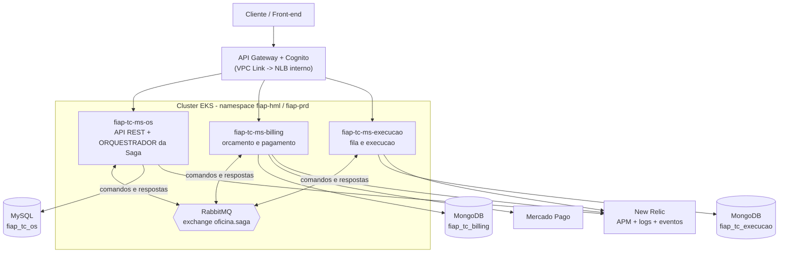
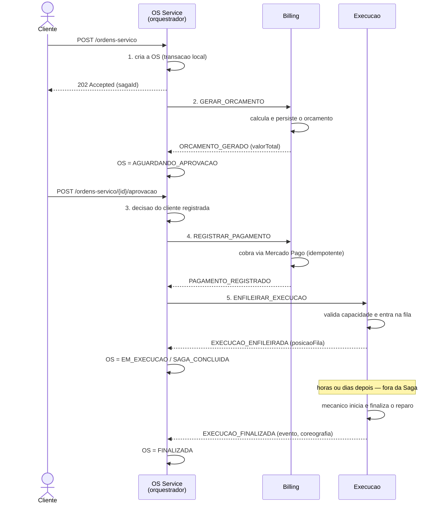
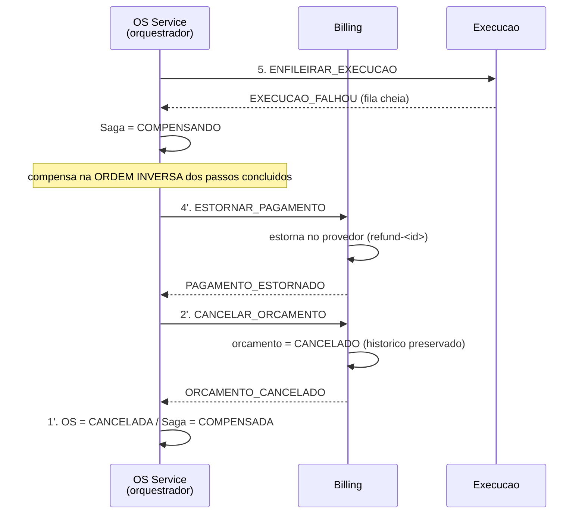
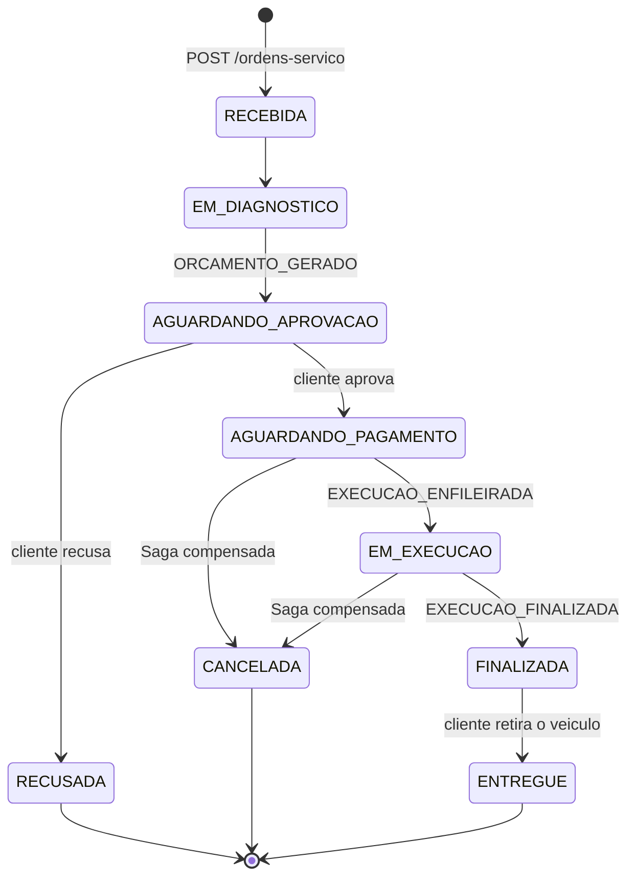
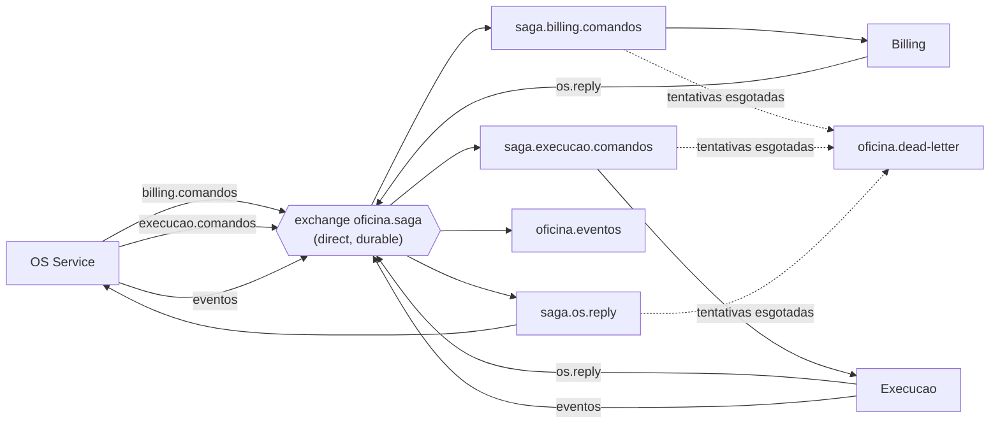
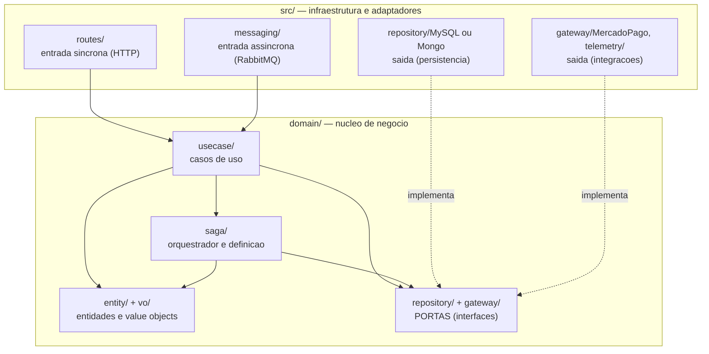
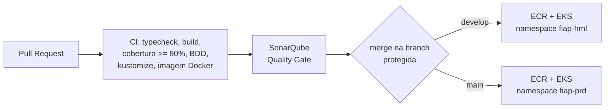

# Arquitetura da Fase 4 — sistema distribuído da oficina

Este documento reúne os diagramas da solução entregue na Fase 4. As decisões
que levaram a ela estão nos ADRs [014](adr/ADR-014-divisao-em-tres-microsservicos.md)
a [018](adr/ADR-018-idempotencia-e-dead-letter.md).

---

## 1. Visão geral — os três microsserviços

**O que o diagrama mostra de propósito:** cada serviço tem **uma única** seta
para **um único** banco. Não existe seta de um serviço para o banco de outro —
e isso não é apenas convenção: o Secret de cada serviço no Kubernetes contém
somente as credenciais do banco dele.

A comunicação entre serviços passa exclusivamente pelo broker. Não há chamada
HTTP de serviço para serviço.

---

## 2. Saga — caminho feliz

---

## 3. Saga — rollback por falha na execução (passo 5)

O caso mais instrutivo: a falha acontece no **último** passo, com pagamento já
confirmado.

Estorna-se o pagamento **antes** de cancelar o orçamento porque o orçamento
cancelado é o documento que justifica o estorno.

---

## 4. Máquina de estados da Ordem de Serviço

Os estados `AGUARDANDO_APROVACAO` e `AGUARDANDO_PAGAMENTO` funcionam como
*Semantic Lock*: sinalizam que o resultado ainda não é definitivo enquanto a
Saga está em andamento.

---

## 5. Topologia de mensageria

A topologia é declarada em código, de forma idempotente, na conexão — os três
ambientes sobem idênticos, sem criação manual de filas.

---

## 6. Camadas de um serviço (Clean Architecture)

O mesmo desenho nos três repositórios. A dependência aponta sempre para dentro.

O núcleo não importa Express, Knex, MongoDB, amqplib nem o SDK do New Relic. É
o que permite que todos os casos de uso e a Saga sejam testados com dublês em
memória, sem contêiner e sem rede.

---

## 7. Pipeline de CI/CD (por repositório)

Cada um dos três repositórios tem esse pipeline de forma **independente**: um
serviço reprovado no gate não impede o deploy dos outros dois.
